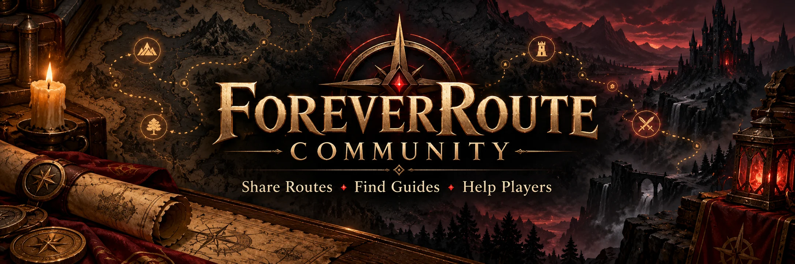

# ForeverRoute Community

Welcome to the official community space for **ForeverRoute**, an independent leveling-route addon and Control Center for **World of Warcraft: Forever**.

[**Join the discussions**](https://github.com/Deciwarrz/ForeverRoute-Community/discussions) · [**Report a bug**](https://github.com/Deciwarrz/ForeverRoute-Issues/issues/new) · [**Download the addon**](https://www.curseforge.com/wow/addons/foreverroute) · [**Support development**](https://ko-fi.com/foreverroute)

The forum is **English only**, so players can find routes, ask questions and search answers in one language.

## Forum categories

### Routes & Guides
- **Shared Routes** — publish original leveling routes, quest order, version and supported profiles.
- **Route Requests** — ask the community to design a route for your faction, race/class and level range.
- **Leveling Guides & Tips** — share class quests, zone strategies, efficient travel and leveling advice.
- **Route Showcase** — post screenshots, demonstrate routing ideas and highlight successful runs.

### Help & Feedback
- **Player Help & Questions** — get answers about gameplay, quest navigation and using ForeverRoute.
- **Feature Suggestions** — share improvement ideas and feature requests.
- **Community Polls** — vote on future priorities and ideas.

### News & Community
- **Official Updates** — announcements from the maintainers.
- **General Chat** — meet other players and discuss WoW Forever.

Report reproducible defects, wrong NPCs, crashes and incorrect waypoints in **[ForeverRoute-Issues](https://github.com/Deciwarrz/ForeverRoute-Issues/issues/new)**. Discussions are for conversations and route-sharing, not technical bug tracking. The private ForeverRoute development source code is not available here.

## Suggested route-sharing template

Open a discussion in **Shared Routes** and include:

```text
Title:
WoW Forever build / version:
ForeverRoute version:
Faction:
Race and class:
Level range:
Solo or group:
Starting zone / finishing zone:
Key quest chain or route notes:
Route code / .frroute file, if supported by your version:
Screenshots (optional):
Creator alias / credit (optional):
```

**Compatibility note:** Shared-route import/export in Control Center is undergoing acceptance testing. Direct share-code import into the in-game addon is planned and must be tested before release. Do not upload executable Lua files as an alternative. Describe your route in text until the appropriate tested version is available.

## Community guidelines

1. Be respectful: no harassment, spam, scams or impersonation.
2. Share only routes and screenshots you created or have permission to distribute. Credit other authors; do not reupload proprietary third-party guides.
3. Never post passwords, account credentials, access tokens, SavedVariables, private file paths or other sensitive data.
4. Do not attach executable scripts, installers, unexpected archives or unknown downloads. Use a validated data-only route format when available.
5. Verify quest details against **WoW Forever** wherever possible; Classic/Vanilla data may differ. State clearly when quest endpoints are unverified.
6. Moderators can remove unsafe or off-topic content, and route creators remain responsible for their shared content.

*ForeverRoute is an independent community project. World of Warcraft names, trademarks and game content belong to their respective rights holders.*


[**Welcome discussion**](https://github.com/Deciwarrz/ForeverRoute-Community/discussions/1)
